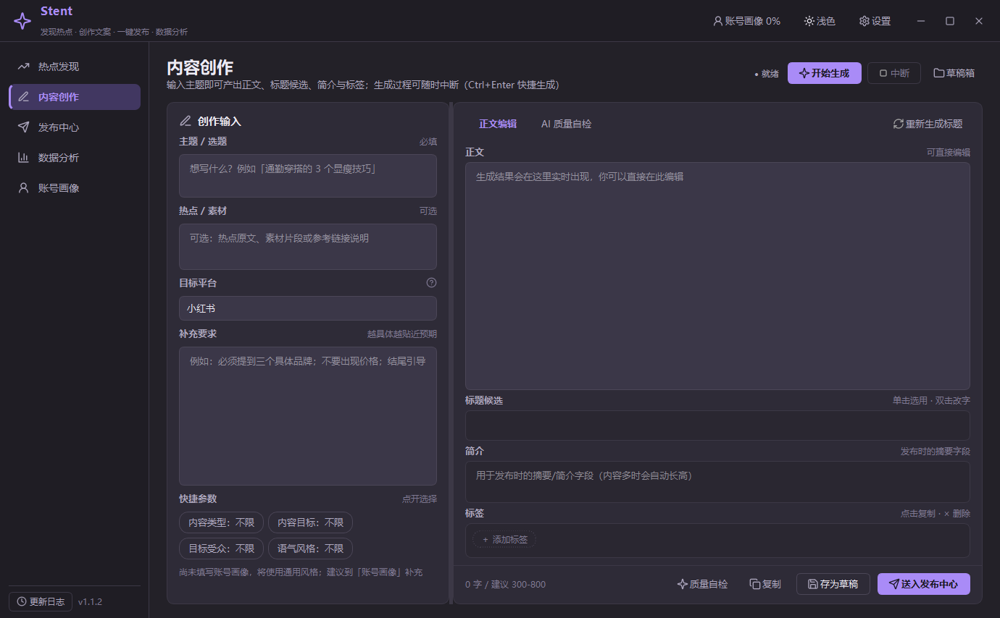
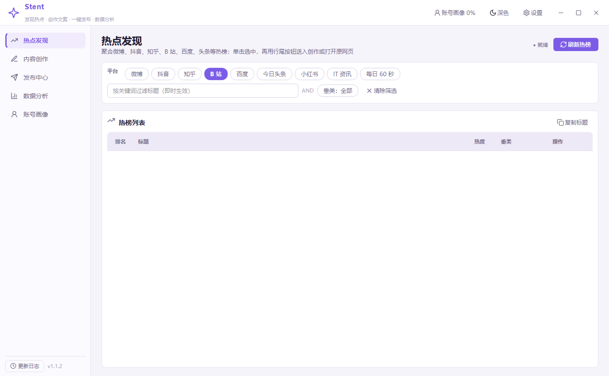
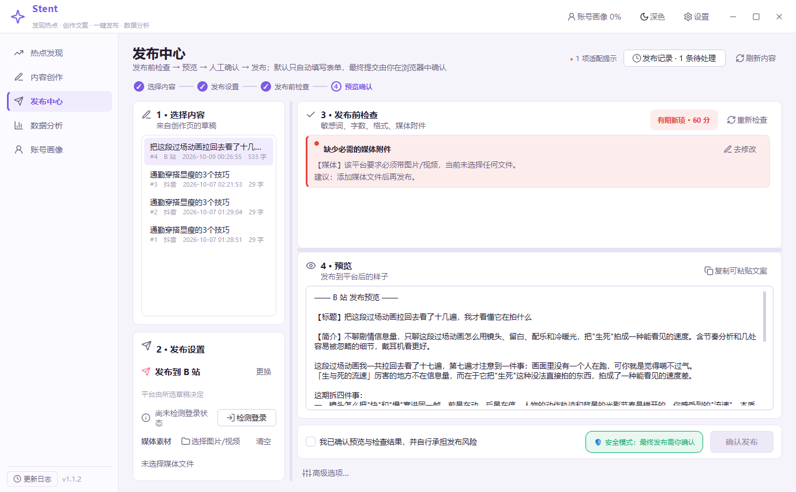
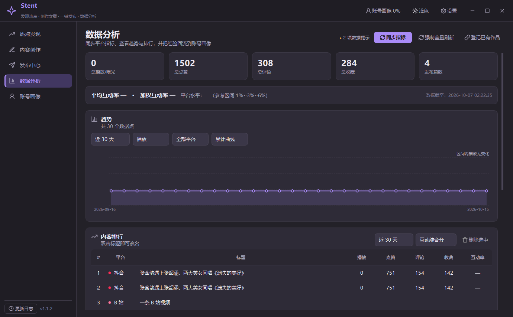

# Stent

<p align="center">
  <strong>基于 Easel 的桌面端社媒内容智能体</strong><br/>
  在同一个窗口里完成「发现热点 → 创作文案 → 一键发布 → 数据分析」的完整闭环<br/>
  覆盖小红书、抖音、知乎、B 站、微博等主流平台
</p>

<p align="center">
  <a href="#许可证与致谢"></a>
  <a href="https://github.com/Ky-l0r/Stent/actions/workflows/ci.yml"></a>
  <a href="https://github.com/Ky-l0r/Stent/releases/latest"></a>
  <a href="#快速开始"></a>
  <a href="#快速开始"></a>
  <a href="https://github.com/ZJU-REAL/Easel"></a>
</p>

---

> [!IMPORTANT]
> Stent 不是 [Easel](https://github.com/ZJU-REAL/Easel) 的 fork，而是对它做「提取 + 重构 + 重新打包」的独立产品：
> 只保留个人创作者真正用得上的四类能力，把 Web + CLI + `.env` 的重型形态，改造成双击即用的 Windows 桌面软件。
> 复用范围与修改声明见 [`NOTICE`](NOTICE)。



## 目录

- [为什么做这个](#为什么做这个)
- [功能特性](#功能特性)
- [快速开始](#快速开始)
- [首次配置](#首次配置)
- [使用流程](#使用流程)
- [界面说明](#界面说明)
- [项目结构](#项目结构)
- [开发与构建](#开发与构建)
- [已知限制](#已知限制)
- [路线图](#路线图)
- [参与贡献](#参与贡献)
- [许可证与致谢](#许可证与致谢)

---

## 为什么做这个

个人创作者的日常是这样断开的：在几个热榜 App 之间刷选题、回到文档里手写文案、下载对应平台的发法说明对齐格式、
再切到平台后台粘贴发布、第二天手动记一遍数据。工具越全，窗口越多。

Stent 把这条链路收进一个桌面窗口：

| 环节 | Stent 做的事 |
|---|---|
| 发现 | 并发聚合 6 个平台热榜，关键词 / 垂类本地筛选，一键送入创作 |
| 创作 | 按平台体例产出正文 + 3 个标题候选 + 简介 + 标签，流式输出可中断 |
| 发布 | 格式适配 → 发布前检查 → 预览 → **人工确认** → 发布，全程留痕 |
| 复盘 | 单篇表现与趋势排行，并把「什么内容有效」回流到账号画像 |

账号画像是这条闭环的枢纽：六维配置（定位 / 风格 / 受众 / 平台 / 偏好 / 记忆）作为高优先级上下文注入每一次创作，
数据分析的归因结论再写回「记忆」，下一次生成自动参考。

## 功能特性

### 🔥 热点发现



- 并发聚合微博、抖音、知乎、B 站、百度、今日头条（另含小红书热搜）；
- 关键词 + 垂类筛选在本地即时完成，双击任意一行送入创作；
- 多平台并发 + 同一平台多源竞速，单一数据源故障不影响整体；结果本地缓存 5~10 分钟。

### ✍️ 内容创作

- 输入主题或热点即产出正文、3 个标题候选、简介与标签；
- 平台体例适配：小红书笔记体 / 抖音口播稿 / 知乎长文 / B 站简介 / 微博短博；
- **流式输出可随时中断**，已生成部分保留；
- **AI 质量自检**按「钩子强度 / 平台匹配度 / 信息价值 / 真人感」四项打分；结果连同内容指纹存本地，
  **内容没变时直接复用上次报告**，不重复消耗 token；内容一改即标为「已过期」并给出重新自检入口；
- 草稿箱保存**完整创作输入**（补充要求与快捷参数一起回来），载入后可用同一组设定重新生成。

### 🚀 发布中心



- 选内容 → 选平台 → 格式适配 → 发布前检查（敏感词 / 字数 / 格式 / 媒体）→ 预览 → **人工确认** → 发布；
- 检查结果按级别分卡展示，**每条右侧都有「去修改」**：带着全部建议跳回创作页，建议横条钉在页面顶部；
- 小红书、抖音、知乎、B 站四个平台的 Playwright 登录与发布适配器；
- 默认行为是**自动填写表单并停在发布前**，由你在浏览器里做最终确认；填完浏览器保持打开（默认最长 10 分钟），
  没能自动填好的项目会明确列出提醒手动补上，而不是静默留空；
- 全程审计留痕。

> [!WARNING]
> 小红书等平台对自动化操作有风控。Stent 默认强制人工确认，**不提供全自动批量发布开关**。
> 「直接自动点击发布」是高级选项，会额外二次确认，**不推荐**。请自行评估账号风险，
> 并遵守各平台的服务条款。

### 📊 数据分析



- 单篇表现（播放 / 点赞 / 评论 / 收藏 / 分享）与趋势、排行；
- **同步指标走增量更新**（默认 30 分钟内不重复拉取），全量刷新可强制重拉；
- 排行标题**双击即可就地改名**（或按 F2），回车保存，其余列保持只读；
- **归因回流**：分析表现最好与最差的内容，产出可复用的内容结构经验并写入账号画像「记忆」。

### 🧩 配置与账号画像

- 图形化配置，只需三项：API Base URL、API Key、模型名称；
- 支持任意 **OpenAI 兼容协议**服务商：OpenAI、DeepSeek、通义千问、Kimi、智谱、硅基流动、Ollama 本地模型，
  以及自建中转（one-api 等）；
- API Key 走系统凭据管理器加密存储（详见[首次配置](#2-api-key-的安全性)）；
- 账号画像支持粘贴一段自我介绍让 AI 生成草稿。

### 🎨 界面

- 淡紫主色的浅色 / 暗色双主题（暗色为灰黑，非纯黑）；
- 无边框窗口，保留 Windows 原生拖拽、Aero Snap、贴边分屏与调整大小能力；
- 右上角状态指示灯常驻汇总页面状态，悬停或点击展开详情；
- 平台品牌色标识、页面懒加载。

实现细节见 [docs/ui-internals.md](docs/ui-internals.md)。

## 快速开始

### 方式一：下载打包产物（推荐）

到 [Releases](https://github.com/Ky-l0r/Stent/releases/latest) 下载 `Stent-vX.Y-win64.zip`，解压后双击 `Stent.exe`。
**无需安装 Python**，数据写在 `%APPDATA%\Stent\`。

发布功能需要 Chromium 内核，任选一种方式准备：

```powershell
python -m playwright install chromium
```

或把打包机上的 `%USERPROFILE%\AppData\Local\ms-playwright` 目录一并分发。

### 方式二：源码运行

环境要求：Windows 10 / 11，Python 3.10+。

```powershell
git clone https://github.com/Ky-l0r/Stent.git
cd Stent

python -m pip install -r requirements.txt
python main.py
```

首次运行会自动创建数据目录与 SQLite 数据库（开发态在 `_data\`），并弹出首次启动引导。

### 方式三：Web 前端（v1.2 实验特性）

界面正在从 PySide6 迁到 Web：同一个业务层，两套壳。Web 版是**独立窗口**（WebView2），
不是浏览器标签页——浏览器模式只用于调试。

```powershell
python -m pip install pywebview         # 只装一次，Windows 上复用系统自带的 WebView2
python main.py --web                    # 独立窗口
python main.py --web --browser          # 只起服务，用浏览器调前端
```

当前 Web 版可用：热点发现、内容创作、账号画像、设置；发布中心只做「检查 + 预览」，不提交。
架构与迁移进度见 [docs/web-architecture.md](docs/web-architecture.md)。旧的 `python main.py` 仍可用。

### 命令行参数

| 参数 | 作用 |
|---|---|
| `--selftest` | 在无界面环境下构建全部页面做冒烟验证后退出 |
| `--reset-onboarding` | 强制重新显示首次启动引导 |
| `--debug` | 输出调试日志 |

日志与数据位置由 `stent/paths.py` 统一管理，可用环境变量 `STENT_DATA_DIR` 覆盖数据目录（自动化测试与绿色部署用）。

## 首次配置

### 1. 配置模型（必须）

打开右上角 **设置 → LLM 接入**，填写三个字段：

| 字段 | 示例 |
|---|---|
| 服务商 | DeepSeek（选中后自动填充下面两项） |
| API Base URL | `https://api.deepseek.com/v1` |
| API Key | `sk-...` |
| 模型名称 | `deepseek-chat` |

点击 **测试连通性** 确认可用后保存。

### 2. API Key 的安全性

- 优先写入 **Windows 凭据管理器**（通过 `keyring`）；
- 若系统凭据管理器不可用，降级为 **DPAPI 加密文件**（仅当前 Windows 用户可解密）；
- 两者都不可用时，密钥只在本次会话内有效，**绝不明文落盘**；
- 设置页会实时显示当前使用的存储方式。

### 3. 填写账号画像（强烈建议）

到 **账号画像** 页填写定位、风格、受众、平台与偏好。画像会作为高优先级上下文注入每次创作，
显著提升文案与账号调性的一致性。也可以粘贴一段自我介绍，让 AI 生成画像草稿。

## 使用流程

```
热点发现 ──「送入创作」──▶ 内容创作 ──「送入发布中心」──▶ 发布中心 ──▶ 数据分析
                                ▲                                        │
                                └──────── 归因回流到账号画像 ◀───────────┘
```

### 热点发现

- 顶部筛选条勾选平台、输入关键词、选择垂类，筛选在本地即时完成；
- **双击任意一行**送入创作；右键可复制标题或打开原链接；
- 数据源优先使用公益接口 60s API（`60s.viki.moe`），失败时自动切换到 xxapi 备用源。

### 内容创作

- `Ctrl+Enter` 快速生成；生成中可点 **中断**，已生成部分保留；
- 生成结束后可在正文框直接编辑；标题候选双击选用、双击改字；
- 右侧编辑区**自适应显示**：正文吸收多余空间，标题候选随条数伸缩，简介按内容自动长高，标签云按行数贴合内容；
  窗口变小时优先压缩正文框，标题 / 简介 / 标签四块保持完整。

### 发布中心

1. 选择内容 → 选择目标平台 → 选择媒体文件（抖音 / B 站 / 小红书需要）；
2. **检测登录**：首次使用点 **去登录**，在弹出的浏览器里扫码；
3. 系统自动完成「格式适配 → 发布前检查 → 预览」；
4. 检查与预览之间是可拖动分栏，默认把更多高度留给预览；检查项多时在检查栏内部滚动，不裁切卡片；
5. 勾选人工确认后点击 **确认发布**（默认只填写不提交，最终由你在浏览器里确认）。

> [!NOTE]
> **B 站的字段口径**：视频简介是 B 站唯一的长文本字段，因此发布时会把创作页的「简介」与「正文」一起填进去
> （重复部分不重复贴），预览区也会单独列出【简介】。
> 分区不写死表——发布时从投稿页的官方接口取**实时分区树**，按「一级 → 二级」自动点选。

### 数据分析

- **同步指标** 增量更新，**全量刷新** 强制重拉；
- 趋势图支持按时间范围、指标、平台、累计 / 单日切换；
- **开始归因** 产出可复用的内容结构经验并写入账号画像。

> [!NOTE]
> **抖音作品信息走轻量通道**：粘贴抖音链接登记作品时，标题与互动数据优先由
> `stent/services/douyin_title.py`（纯标准库，不启动浏览器）从移动端分享页 / 详情接口获取，
> 拿不到时才回退到 Playwright。既避开「桌面端页面标题渲染成『抖音创作者中心』」的老问题，
> 也省掉一次十几秒的浏览器启动。

## 界面说明

### 窗口与快捷键

| 操作 | 行为 |
|---|---|
| 长按顶栏拖动 | 移动窗口；拖到屏幕左 / 右边缘自动分屏，拖到顶部最大化 |
| 拖到顶部停住 | 呼出系统 Snap 布局选择器（Windows 11） |
| 双击顶栏 | 最大化 / 还原 |
| 悬停「最大化」按钮 | 呼出 Snap 布局选择器（Windows 11） |
| 拖拽窗口四边 / 四角 | 调整窗口大小 |
| `F11` / `Esc` | 进入全屏 / 退出全屏 |
| `Ctrl+M` | 最大化 / 还原 |

系统级对话框（文件选择、消息框、引导页）仍保留原生标题栏——它们由系统绘制，也更符合用户对弹窗的操作预期。
**为什么无边框窗口还能有 Snap 和原生调整大小**，见 [docs/ui-internals.md](docs/ui-internals.md)。

### 主题

- **浅色**：淡紫主色（`#7C5CE6`）+ 中性灰白底，适合白天与投屏；
- **暗色**：背景取灰黑（`#232128`）而非纯黑，长时间使用不刺眼；语义提示底色随主题变暗
  （例如警告色底为暗金棕 `#3A3324`，而不是扎眼的浅黄）。

切换方式：顶栏右侧的月亮 / 太阳按钮，或「设置 → 通用 → 界面主题」。

### 状态指示灯

页面右上角的小胶囊**常驻显示**，汇总当前页面运行状态；空闲时显示中性的 `● 就绪`。

| 颜色 | 含义 | 示例 |
|---|---|---|
| 灰 | 就绪（空闲） | ● 就绪 |
| 紫 | 进行中 | ● 正在并发拉取各平台热榜… |
| 绿 | 正常 | ● 6 平台正常 · 检查通过 · 94 分 |
| 黄 | 降级 | ● 6 平台 · 2 缓存 · 未安装浏览器内核 |
| 红 | 失败 | ● 生成失败 · 检查未通过 |

**鼠标悬停或点击**可展开完整详情，页面顶部的主视觉始终留给标题与主要操作按钮。

### 平台品牌色

所有出现平台的列表都会在平台名前绘制该平台的品牌色圆点：

| 平台 | 色值 | 平台 | 色值 |
|---|---|---|---|
| 小红书 | `#FF2E4D` | 微博 | `#E6162D` |
| 抖音 | `#FE2C55` | 百度 | `#2932E1` |
| 知乎 | `#0F88EB` | 今日头条 | `#F04142` |
| B 站 | `#FB7299` | | |

侧栏底部提供「版本更新日志」入口，内容读取随包分发的 [`CHANGELOG.md`](CHANGELOG.md)。

## 项目结构

```
Stent/
├── main.py                     入口脚本
├── build.ps1                   一键打包
├── Stent.spec                  PyInstaller 配置（onedir）
├── pyproject.toml              项目元数据、依赖与 ruff / pytest 配置（唯一真源）
├── .editorconfig / .gitattributes / .pre-commit-config.yaml
├── .github/workflows/ci.yml    静态检查 + 服务层自检 + 界面冒烟
├── stent/
│   ├── app.py                  应用启动、日志、冒烟自检
│   ├── paths.py                路径管理（数据/配置/缓存/浏览器目录）
│   ├── config.py               配置中心 + keyring/DPAPI 密钥存储
│   ├── api/                    本机 HTTP 接口层（server 路由/SSE、handlers 端点）
│   ├── webapp.py               Web 前端桌面壳（WebView2 窗口）
│   ├── web/                    前端静态资源（index.html + assets，原生 ES Module）
│   ├── core/
│   │   ├── db.py               SQLite 存储层（内容/发布/指标/画像/热榜/日志）
│   │   └── llm.py              OpenAI 兼容客户端（流式、重试、可中断）
│   ├── services/
│   │   ├── hotsearch.py        热点发现（6 平台并发 + 多源竞速 + 缓存）
│   │   ├── creator.py          内容创作（平台体例 + 流式分段解析 + 画像注入）
│   │   ├── profile.py          账号画像六维
│   │   ├── precheck.py         发布前检查（敏感词/字数/格式/媒体/风控）
│   │   ├── publisher.py        发布编排（强制人工确认 + 审计留痕）
│   │   ├── douyin_title.py     抖音作品信息轻量抓取（纯标准库，不启浏览器）
│   │   └── analytics.py        数据分析与归因回流
│   ├── platforms/
│   │   ├── base.py             适配器统一接口
│   │   ├── _browser.py         Playwright 持久化上下文与人工核对保持
│   │   ├── xiaohongshu.py      小红书
│   │   ├── douyin.py           抖音
│   │   ├── zhihu.py            知乎
│   │   └── bilibili.py         B 站
│   ├── resources/
│   │   └── sensitive_words.txt 敏感词与风险词表（718 条 / 16 分节）
│   ├── skills/                 从 Easel 裁剪的 prompt 资产（可查阅）
│   └── ui/
│       ├── main_window.py      顶栏 + 侧栏 + 卡化主区
│       ├── frameless.py        无边框窗口（原生拖拽/Snap/调整大小/圆角/阴影）
│       ├── theme.py            淡紫浅色 / 灰黑暗色主题与 QSS
│       ├── icons.py            线性图标（内联 Lucide SVG）
│       ├── components.py       卡片、状态指示灯、平台色委托、趋势图等
│       ├── qt_guard.py         控件父级守卫（消除切换页面时的小窗口闪现）
│       ├── wheel_guard.py      滚轮守卫（悬停滚动不误改数值）
│       ├── dialogs.py          版本更新日志等对话框
│       ├── workers.py          后台任务线程封装
│       └── pages/              七个页面（含引导页）
├── tests/                      自检与回归脚本 + 工程一致性校验（见 docs/development.md）
├── docs/                       开发文档与截图
├── CHANGELOG.md                更新日志（应用内「版本更新日志」入口读取）
├── AGENTS.md                   AI 编码代理的项目约定（门禁型）
├── CONTRIBUTING.md             贡献指南
├── LICENSE                     Apache-2.0
└── NOTICE                      上游来源与修改声明
```

## 开发与构建

打包、自检清单、平台改版取证流程、性能指标与实现取舍，集中在
[docs/development.md](docs/development.md)；无边框窗口的 Win32 实现细节在
[docs/ui-internals.md](docs/ui-internals.md)；Web 前端的架构、职责划分与迁移要点在
[docs/web-architecture.md](docs/web-architecture.md)。

一句话版：

```powershell
ruff check . && ruff format --check .   # 静态检查（规则见 pyproject.toml）
python tests/check_project.py           # 版本号 / CHANGELOG / 依赖口径一致
python tests/selftest_all.py            # 服务层端到端自检（当前 171 项）
$env:QT_QPA_PLATFORM='offscreen'; python main.py --selftest   # 界面层冒烟
pwsh -File build.ps1 -Clean             # 一键打包，产物 dist\Stent\Stent.exe
```

改 UI 时建议用 `python main.py` 直接跑源码验证，不必每次都重新打包（`build.ps1` 一次约 2 分半）。
提交前建议 `pre-commit install` 装一次钩子，上面前两条会自动跑。

## 已知限制

产品边界（明确**不做**的事）：

- 视频剪辑、AI 生视频、AI 音乐、声音克隆
- 短剧生成、小说创作、论文解读
- 内容日历、直播策划、商单方案
- 多账号矩阵、团队协作、云端同步

技术层面的已知限制：

1. **平台选择器需真机验证**。四个平台的适配器基于上游在 2026 年中的实现移植，平台前端改版会导致选择器失效。
   首次使用建议先用「确认发布」的默认模式（只填写不提交）走一遍。改版取证流程见
   [docs/development.md](docs/development.md#平台改版时怎么取证)。
2. **浏览量可能取不到**。小红书网页版不公开曝光 / 浏览数，取不到时记 0；抖音 / 知乎的阅读量在部分入口也不公开。
   数据分析中的「互动率」因此可能缺少分母。
3. **发布是单人单次操作**。同一平台的浏览器操作会串行执行，避免登录态冲突；不提供批量发布。
4. **热点源为公益接口**。60s API 与 xxapi 均为公益项目，偶发超时；Stent 会自动降级到备用源或历史缓存，
   并如实标注数据时效。
5. **打包体积**。PySide6 本体约 100~150MB；Chromium 内核默认不内置，需要用户侧安装或额外分发。
6. **图片尺寸与视频时长校验未实现**，当前只检查文件是否存在、数量与扩展名是否合法。
7. **仅支持 Windows**。无边框窗口的拖拽 / Snap / 圆角实现依赖 Win32 与 DWM 接口，未在 macOS / Linux 验证。

## 路线图

| 方向 | 具体内容 |
|---|---|
| 发布可靠性 | 图片尺寸与视频时长校验；发布结果自动回填（检测投稿成功页并落库） |
| 平台覆盖 | 微信视频号、公众号；已有适配器的选择器分层兜底 |
| 数据口径 | 更多平台的指标增量同步；导出 CSV / Markdown 报表 |
| 创作质量 | 账号画像记忆的可解释与手动编辑；多轮改稿的上下文压缩 |
| 可移植性 | 评估 macOS / Linux 的窗口与凭据方案 |

想推动某一项？欢迎[开 Issue 或提 PR](CONTRIBUTING.md)。

## 参与贡献

欢迎提 Issue 与 Pull Request。开始前请读
[CONTRIBUTING.md](CONTRIBUTING.md)，里面有环境搭建、代码约定、
提交前必须跑的自检命令，以及 commit / PR 规范。

- 报平台改版导致的发布失败：请用 [Bug 报告模板](.github/ISSUE_TEMPLATE/bug_report.md)，
  附上「现场」路径与 `stent.log` 片段；
- 提新功能或想调整产品边界：请用 [功能请求模板](.github/ISSUE_TEMPLATE/feature_request.md)。

## 许可证与致谢

本项目以 **Apache License 2.0** 发布，见 [LICENSE](LICENSE)。复用内容与修改声明见 [NOTICE](NOTICE)。

核心致谢：

- **[Easel](https://github.com/ZJU-REAL/Easel)**（Apache-2.0）——
  本项目的技术底座，热榜聚合逻辑、平台规范、发布流程、数据分析口径均提取自该项目。
- **[xpzouying/xiaohongshu-mcp](https://github.com/xpzouying/xiaohongshu-mcp)**（Apache-2.0）——
  Easel 的小红书发布实现参考了该项目，Stent 的选择器沿用同一来源。
- **[Lucide](https://lucide.dev/)**（ISC）—— 界面线性图标。

> [!NOTE]
> 本项目用于个人内容创作与发布辅助。使用者需自行确保对发布内容的著作权与平台规则的合规性，
> 并自行承担账号风险。
